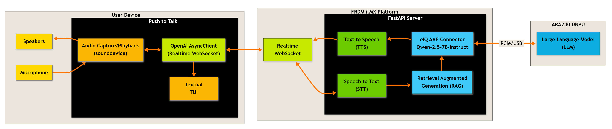
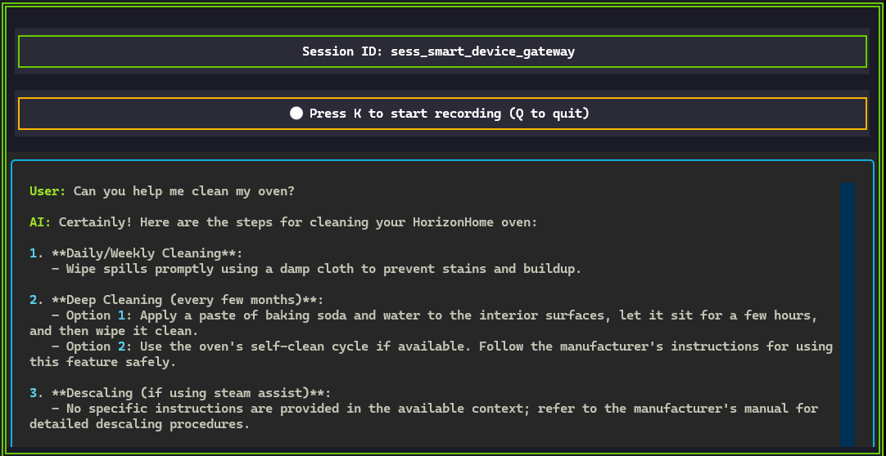
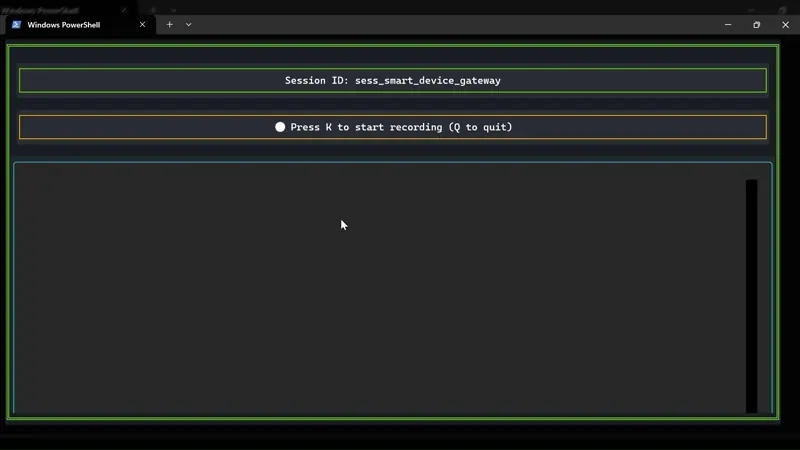

[](https://www.nxp.com)
# Smart Device Gateway

[](./LICENSE)
[](https://www.python.org)
[](https://www.nxp.com/design/design-center/development-boards-and-designs/FRDM-IMX8MPLUS)
[](https://www.nxp.com/design/design-center/development-boards-and-designs/FRDM-IMX95)
[](https://www.nxp.com/design/design-center/development-boards-and-designs/FRDM-IMX95-PRO)
[](https://mcuxpresso.nxp.com/appcodehub?category=voice)
[](https://mcuxpresso.nxp.com/appcodehub?category=aiml)
[](https://www.nxp.com/design/design-center/software/embedded-software/i-mx-software/embedded-linux-for-i-mx-applications-processors:IMXLINUX)

A server that transforms your devices into intelligent assistants.</br>
Imagine a world where every device in your enviroment becomes intelligent—without needing powerful AI hardware.
Your coffee maker, thermostat, smart mirror, or even your vintage radio can now engage in natural conversations with you. The secret? They don't need to be smart themselves. They just need a microphone, a speaker, and a connection to your **Smart Device Gateway**.

## Table of Contents
1. [Software](#step1)
2. [Hardware](#step2)
3. [Setup](#step3)
4. [Results](#step4)
5. [FAQs](#step5)
6. [Support](#step6)
7. [Release Notes](#step7)

## 1. Software<a name="step1"></a>
### 1.1 The Vision
This demo application transforms the way we interact with everyday devices. Instead of embedding expensive AI chips into every device,
our architecture centralizes intelligence in one powerful server.
Your devices become **voice-enabled endpoints**—lightweight, affordable, and infinitely capable.

### 1.2 Software Architecture

This demo application adopts the following architecture:


#### 1.2.1 Architecture Components

- **STT**: Transcribes incoming audio streams to text: Powered by [Moonshine](https://huggingface.co/UsefulSensors/moonshine).
- **RAG**: Retrieves relevant context from your knowledge base: Using [all-MiniLM-L6-v2](https://huggingface.co/sentence-transformers/all-MiniLM-L6-v2) as the embedding model.
- **LLM**: Processes queries and generates contextual responses: Powered by [Qwen-2.5-7B-Instruct](https://huggingface.co/nxp/Qwen2.5-7B-Instruct-Ara240) running on the Ara240 DNPU accelerator being accessed via the eIQ AAF Connector.
- **TTS**: Synthesizes natural-sounding speech from text responses: Using [VITS-based model](https://huggingface.co/rhasspy/piper-voices/blob/main/en/en_US/amy/medium/MODEL_CARD) for high-quality voice synthesis.

##### OpenAI-Compatible Realtime API

This application implements an **OpenAI Realtime API-compatible WebSocket endpoint** (`/v1/realtime`), enabling seamless integration with any client that supports the OpenAI Realtime API protocol.

##### What is the OpenAI Realtime API?

Unlike the traditional REST API (`/v1/chat/completions`), the **OpenAI Realtime API** uses WebSocket connections for:
- **Bidirectional audio streaming** (audio in → audio out)
- **Low-latency voice conversations**
- **Real-time function calling and interruptions** (In progress)

##### Universal WebSocket Compatibility

Our server runs behind the `/v1/realtime` WebSocket endpoint, providing full API compatibility. This means **any device or application that can establish a WebSocket connection** can interact with the Smart Device Gateway—no special hardware or SDKs required.

Connect to the server using:

```
wss://{server-ip-address}/v1/realtime
```

This architecture ensures that whether you're using a web browser, mobile app, embedded device, or desktop application, as long as it supports WebSockets, it can become part of your intelligent ecosystem. We encourage you to review the code of the [push to talk app](./push_to_talk/) to see a practical example of how to implement a WebSocket client.

## 2. Hardware<a name="step2"></a>
### 2.1 Supported Platforms

| Platform                                                                                                    | Supported |
| ----------------------------------------------------------------------------------------------------------- | :-------: |
| [FRDM i.MX 8M Plus](https://www.nxp.com/design/design-center/development-boards-and-designs/FRDM-IMX8MPLUS) |     ✅     |
| [FRDM i.MX 95](https://www.nxp.com/design/design-center/development-boards-and-designs/FRDM-IMX95)          |     ✅     |
| [FRDM i.MX 95 Pro](https://www.nxp.com/design/design-center/development-boards-and-designs/FRDM-IMX95-PRO)  |     ✅     |

### 2.2 Required hardware

- Supported FRDM i.MX platform
- microSD card (recommended size >=64 GB)
- [Ara240 16GB M.2 Module](https://www.nxp.com/design/design-center/development-boards-and-designs/ARA2-M2-16G-GT)
- USB-C power supply (5V/3A recommended)
- 1920x1080 HDMI display monitor
- HDMI cable
- USB mouse
- Two USB-C to USB-A debug cables

## 3. Setup<a name="step3"></a>

Since **Smart Device Gateway** is already part of i.MX Linux BSP, you can simply download a pre-built BSP image from NXP's Official website and flash it to your FRDM i.MX board to install it.
The detailed steps for testing this application are provided below.

### 3.1 Installation
Since the application consists of separate client and server components that run on different devices, each component must be installed independently.

#### 3.1.1 Server Side
1. Download the Linux i.MX image (version 6.18.20_2.0.0 or greater) corresponding to your FRDM i.MX board from [Embedded Linux for i.MX](https://www.nxp.com/design/design-center/software/embedded-software/i-mx-software/embedded-linux-for-i-mx-applications-processors:IMXLINUX).
2. Download the [Universal Update Utility](https://github.com/nxp-imx/mfgtools) (release version 1.5.243 or latest).
3. Configure the Boot Switch on the FRDM board to *serial downloader* mode (make sure the board is turned off), please refer to the Quick Start Guide corresponding to yout FRDM i.MX board for this step:
	- [FRDM i.MX 8M Plus Quick Start Guide](https://www.nxp.com/docs/en/quick-reference-guide/FRDMIMX8MPLUSQSG.pdf)
	- [FRDM i.MX 95 Quick Start Guide](https://www.nxp.com/docs/en/quick-reference-guide/FRDMIMX95QSG.pdf)
	- [FRDM i.MX 95 Pro Quick Start Guide](https://www.nxp.com/docs/en/user-guide/FRDMIMX95PROQSG.pdf)
4. Insert the SD card in the FRDM i.MX board.
5. Connect your FRDM i.MX board to the power supply and connect its USB-C and DEBUG ports to your host machine.
6. Open a terminal in your host machine and run the Universal Update Utility using the following command along with the `.bin-flash` file and the `.wic` image corresponding to your FRDM i.MX board:
	```bash
	.\uuu.exe -b sd_all <imx-boot-*.bin-flash> <imx-image-full-*.wic>
	```
7. Power on the FRDM i.MX board and wait for the flashing process to complete.

#### 3.1.2 Client side
The client side must be installed in the user's device which can be a Linux, Mac OS or Windows PC.</br>
To install the client, simply copy the [push_to_talk](./push_to_talk) directory to your host machine in the location of your choice.

### 3.2 Running Smart Device Gateway
#### 3.2.1 Server side

This application is already available in NXP's [GoPoint for i.MX Applications Processors](https://www.nxp.com/design/design-center/software/i-mx-developer-resources/gopoint-for-i-mx-applications-processors:GOPOINT) launcher, to run it follow the next steps:
1. Connect the HDMI display, keyboard and mouse to your FRDM i.MX board (a USB hub might be needed).
2. Configure the Boot Switch on the FRDM board to *USDHC2 4-bit SD3.0* mode (make sure the board is turned off).
3. Connect the **Ara240 16GB M.2 Module** to the FRDM i.MX board.
4. Power on the FRDM i.MX board and wait for the boot process to complete.
5. Connect the FRDM i.MX board to the internet, for detailed information about Wi-Fi or Ethernet connectivity please refer to [i.MX Linux User's Guide](https://www.nxp.com/docs/en/user-guide/UG10163.pdf) chapter 11.
6. Once the boot process is completed click the **GoPoint** icon that appears in the upper left corner of the screen.
7. Navigate inside **GoPoint** interface and select **Smart Device Gateway**, then click the **Launch Demo** button.
> **Note:** When the application is run for the first time, a supported LLM is automatically downloaded. This may take several minutes, depending on your network connection. Please wait until the `Application startup complete` log message appears before launching the client side.

#### 3.2.2 Client side
1. Inside the folder, run the following command: `python -m uv run push_to_talk.py --server_ip $YOUR_BOARD_IP --port $PORT --device [oven / barista]`
2. You should see the following TUI. Press K to start recording and press it again to send your query to server.
> **Note:** On Mac, you'll also need brew install portaudio ffmpeg.
> On Linux, you'll also need sudo apt-get install portaudio19-dev ffmpeg  
> **Note:** If you don't provide a device name, the RAG will not be used. You can ask anything you want, and the server will respond based on the LLM's knowledge.

<div align="center">
  
</div>

> For more details about this application, please refer to its [README](./push_to_talk/README.md) file.

## 4. Results<a name="step4"></a>
Once the installation is complete and both sides, client and server are running, the application is quite simple to use. </br>
Here's how it works:
1. **🎤 Speak Naturally**: Talk to any connected device (don't forget presing "k" to begin and stop recording).
2. **🧠 Intelligent Recognition**: The Gateway identifies which device you're using and understands the context of your environment.
3. **📚 Personalized Knowledge**: Each device can access its own specialized knowledge.
4. **🔊 Instant Response**: Get natural, spoken answers streamed back in real-time, tailored to your device and needs.

 <div align="center">
    <br></br>
   <figure>
     
   </figure>
 </div>

 <div align="center">
   <em> Preview 1. Demonstration of Smart Device Gateway client (Push to Talk) running on a Windows Host machine, receiving AI assistance from the Smart Device Gateway server, which runs on the FRDM i.MX board along with the Ara240 DNPU module. </em>
   <br></br>
</div>

### The Magic Behind the Scenes

Every connected appliance becomes part of an intelligent ecosystem:
- **Context-Rich Responses**: Each device can tap into its own RAG (Retrieval-Augmented Generation) database—recipe collections, user manuals, personal notes, or domain-specific knowledge.
- **Privacy-First Design**: Your voice never leaves your premises. Everything runs locally, keeping your conversations private and secure.
- **Universal Compatibility**: Any device with a microphone and speaker can join the ecosystem—no AI processing power required.

> **🎯 Current Release:** This version showcases the power of our architecture with a generic oven and a generic coffee machine as your intelligent devices.
> Every client connected to the Gateway becomes a voice-enabled assistant, ready to answer your questions,
> explain features, and guide you through the different manuals. **We recommend reviewing the [user manuals](./assets/generic_manuals) to discover the full range of questions that your devices can answer**.
> The Gateway draws its expertise directly from this knowledge base to provide accurate, contextual responses.

## 5. FAQs<a name="step5"></a>

To ensure the best experience with the Smart Device Gateway, please keep the following points in mind:

### 5.1 Microphone Quality Matters
The quality of your microphone directly impacts transcription accuracy. For optimal results:
- Use a high-quality microphone with good noise cancellation
- Minimize background noise during recording
- Speak clearly and at a moderate pace

### 5.2 Speech Recognition Sensitivity
The STT (Speech-to-Text) model used in this demo is **highly sensitive to accents and pronunciation variations**. If you experience transcription issues:
- Try speaking more slowly and enunciating clearly
- Use standard pronunciation when possible
- Be aware that strong regional accents may affect accuracy

### 5.3 Knowledge Base Boundaries
For the best responses, **formulate queries that align with the information available in the device manuals**. The system works best when:
- Questions relate directly to features, operations, or specifications covered in the [user manuals](./assets/generic_manuals)
- Queries are specific to the selected device (oven or barista)
- Questions focus on practical usage, troubleshooting, or device capabilities

## 6. Support<a name="step6"></a>

#### Project Metadata

<!----- Boards ----->
[](https://www.nxp.com/design/design-center/development-boards-and-designs/FRDM-IMX8MPLUS)
[](https://www.nxp.com/design/design-center/development-boards-and-designs/FRDM-IMX95)
[](https://www.nxp.com/design/design-center/development-boards-and-designs/FRDM-IMX95-PRO)

<!----- Categories ----->
[](https://mcuxpresso.nxp.com/appcodehub?category=voice)
[](https://mcuxpresso.nxp.com/appcodehub?category=aiml)

<!----- Peripherals ----->
[](https://mcuxpresso.nxp.com/appcodehub?peripheral=wifi)
[](https://mcuxpresso.nxp.com/appcodehub?peripheral=ethernet)

<!----- Toolchains ----->
[](https://mcuxpresso.nxp.com/appcodehub?toolchain=gcc)

Questions regarding the content/correctness of this example can be entered as Issues within this GitHub repository.

>**Note**: For more general technical questions regarding NXP Microcontrollers and the difference in expected functionality, enter your questions on the [NXP Community Forum](https://community.nxp.com/)

[](https://www.youtube.com/NXP_Semiconductors)
[](https://www.linkedin.com/company/nxp-semiconductors)
[](https://www.facebook.com/nxpsemi/)
[](https://x.com/NXP)

## 7. Release Notes<a name="step7"></a>

| Version | Description / Update                           | Date                        |
|:-------:|------------------------------------------------|----------------------------:|
| 1.0     | Initial release on Application Code Hub        | September 30<sup>th</sup> 2026 |

## License
This repository is licensed under the [LA_OPT_Online Code Hosting NXP_Software_License](./LICENSE).
